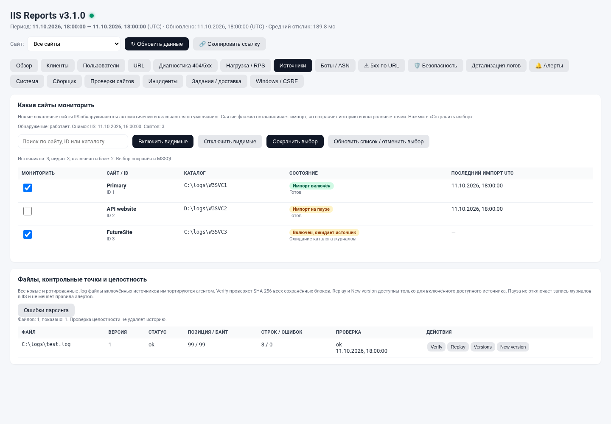

# IIS Reports 3.1.0 — Auto Sites

> **SETUP-FIX1:** создание защищённых папок без запуска `icacls.exe`; отдельная проверка настоящего SQL-соединения. [Инструкция](docs/HOTFIX-SETUP.md).

> **BUILD-FIX1:** обновлён скрипт сборки для диагностики отсутствующего `UnitTests.exe`. Приложение и SQL не меняются. [Установка исправления и журналы сборки](docs/HOTFIX-BUILD.md).

**Анализ журналов IIS с автоматическим обнаружением всех локальных сайтов и управлением импортом через флажки в веб-интерфейсе.**

IIS + ASP.NET .NET Framework + Microsoft SQL Server + Windows-служба. Без внешних JavaScript CDN. Полные исходники службы включены.

> Базового IIS недостаточно: нужны компоненты ASP.NET/Windows Authentication, .NET Framework 4.8 или 4.8.1 и отдельный либо локальный SQL Server. Установщик компонентов не скачивает SQL Server. Это поставка исходников: EXE собирается на Windows включённым скриптом.

## Начало работы

- **[Чистая установка](docs/INSTALL.md)** — с нуля, без прежнего `Web.config`, без ручных SiteId/путей.
- **[Обновление с 3.0.2 / SQLCONN-FIX1](docs/UPGRADING.md)** — сохранение конфигурации и истории.
- **[Автоматическое обнаружение и флажки](docs/AUTO-SOURCES.md)** — что включается, что означает пауза.
- [Требования](docs/PREREQUISITES.md) · [SQL](docs/DATABASE.md) · [Безопасность / CSRF](docs/SECURITY.md) · [Ошибки](docs/TROUBLESHOOTING.md)
- [API](docs/API.md) · [Тестирование](docs/TESTING.md) · [Исходники EXE](agent/SOURCE-MAP.md) · [Изменения](CHANGELOG.md)

## Что нового

Все впервые обнаруженные сайты включаются автоматически. Вкладка **«Источники»** показывает флажок для каждого источника, его каталог, доступность и состояние импорта. Есть поиск, массовое включение/отключение видимых строк и сохранение выбора.

Выбор хранится в MSSQL и не сбрасывается при очередном обнаружении или перезапуске. Отключение сохраняет историю и контрольную точку; включение возобновляет чтение с неё. Новые сайты и новые файлы журналов подхватываются без ручного запуска скрипта регистрации.



*Иллюстрация снята в браузерном тесте с подставными ответами API; это не результаты реального сервера.*

## Возможности

| Область | Состав |
|---|---|
| Аналитика | Обзор, клиенты, пользователи, URL, 404/5xx, подстатусы, источники переходов, CSV |
| Нагрузка | Временные графики, RPS/RPM, времена ответа, персентили, сравнение периодов |
| Импорт | Инкрементальное чтение, сохранение смещений, сырые записи и карантин, SHA-256 блоков, версии файлов |
| Мониторинг | Проверки URL, редактор правил, инциденты, очередь JSON-webhook и повторные попытки |
| Источники | Автообнаружение существующих/новых IIS-сайтов, флажки, массовые действия, ревизии и аудит |
| Доступ | Windows Authentication, раздельные роли, CSRF, канонический публичный Origin |
| Обогащение | Локальные CSV GeoIP/ASN для IPv4, эвристические признаки ботов |

Под «все логи» понимаются файловые **W3C-журналы локальных сайтов IIS**, не любые журналы Windows. Неподдерживаемые форматы отображаются с причиной.

## Архитектура

```text
Конфигурация IIS
      |
Задача SYSTEM (только обнаружение и ACL журналов)
      |
Защищённый JSON-снимок ----> Windows-агент <---- W3C *.log
                                  |
                            MSSQL / ir3
                                  |
                         ASP.NET + браузер
                         (выбор источников)
```

Служба не запускается под SYSTEM. Отдельная короткая задача SYSTEM только читает список IIS-сайтов и добавляет право чтения каталогов журналов; её скрипты недоступны службе на запись. Импорт, MSSQL и доставка уведомлений остаются в непривилегированном агенте.

## Размещение

```text
C:\Deploy\IISReports-3.1.0\           проект, тесты, документация
C:\Deploy\IISReports-config\         подготовленные защищённые конфиги
C:\inetpub\wwwroot\IISReportsV3\     только содержимое web/
C:\Services\IISReportsAgentV3\       EXE, конфигурация и logs
%ProgramData%\IISReports\Discovery\  защищённый издатель снимка IIS
```

Не публикуйте весь ZIP в `wwwroot`. SQL-скрипты, исходники службы и установочные инструменты не должны обслуживаться IIS.

## Сборка

На Windows PowerShell 5.1 x64:

```powershell
$pkg = 'C:\Deploy\IISReports-3.1.0'
& "$pkg\tools\Verify-Package.ps1"
& "$pkg\tools\Install-Prerequisites.ps1" -InstallMissing
& "$pkg\tools\Build-And-Test.ps1"
```

Установку продолжайте по [INSTALL.md](docs/INSTALL.md). Команд регистрации каждого сайта и переменных `$sourceSiteId`, `$sourceName`, `$logRoot` в основном сценарии больше нет.

Результат сборки — `build\IISReports.Agent.exe`. Самостоятельные исходники и отдельный сборщик также находятся в `agent/source/`.

```powershell
& "$pkg\tools\Make-Windows-Release.ps1" -SkipBuild
```

Создаёт Windows-релиз с собранными файлами и исходниками; рабочие конфиги/пароли в него не включаются.

## SQL и совместимость

Нужна схема **310**: базовый установщик `001-v3-schema.sql`, затем добавочная миграция `005-auto-sources.sql`. `Initialize-Database.ps1` выполняет оба. 19 таблиц, прежние запросы/смещения сохраняются. SQLCONN-FIX1 включён.

Старые `dbo`-таблицы остаются, но не объединяются с аналитикой `ir3`. Существующие источники v3 сохраняют свой `Enabled`; новые включаются по умолчанию. Один IIS-сервер/агент на одну БД.

## Проверки и ограничения выпуска

Браузерные сценарии с подставным API и переносимые проверки согласованности выполнены при упаковке. Компиляция C# в Windows, запуск задачи SYSTEM, SQL-интеграция, NTLM/Kerberos и реальная отправка webhook требуют проверки на целевом сервере. См. [TESTING.md](docs/TESTING.md) и включённый отчёт.

В комплекте нет сторонних GeoIP-баз, закрытых ключей, SQL-паролей и предварительно собранного Windows EXE. Проверяйте источник ZIP; SHA256 проверяет целостность, а не авторство.

## Разработка

[CONTRIBUTING.md](CONTRIBUTING.md) · [SECURITY.md](SECURITY.md) · [NOTICE.md](NOTICE.md)

Шаблоны Issues и Windows CI лежат в `.github/`. Этот архив можно разместить в собственном репозитории; автоматически репозиторий не создаётся.
